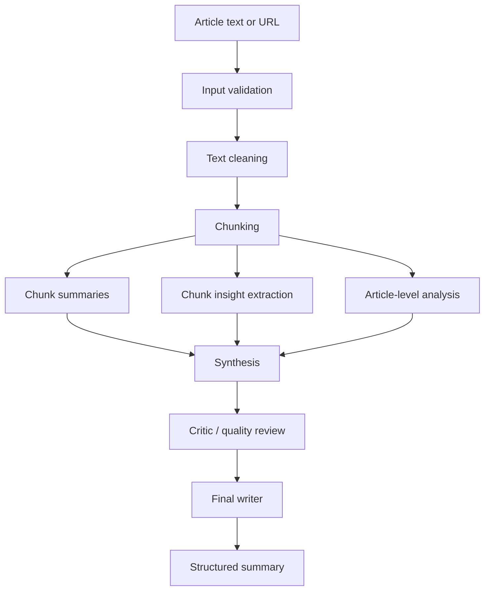

# AI Article Summarizer

<p align="center">
  <strong>Turn long-form articles into clear, structured, source-grounded summaries.</strong>
  <br />
  A full-stack application built with React, FastAPI, and a multi-stage LangChain workflow.
</p>

<p align="center">
  
  
  
  
  
</p>

---

## Overview

**AI Article Summarizer** is a full-stack application that transforms lengthy articles into concise, structured summaries. Instead of relying on a single prompt, the backend coordinates multiple LangChain stages to analyze the article, process its sections, extract insights, synthesize a draft, review that draft against the source, and generate the final result.

Users can paste article text or provide a public article URL, choose a summary length, and review the generated output in a clean React interface.

The project focuses on **grounded summarization, modular LLM orchestration, structured outputs, and resilient processing**.

## Key Features

- **Multi-stage summarization:** separates article analysis, chunk summarization, insight extraction, synthesis, quality review, and final writing.
- **Long-article processing:** splits content into overlapping chunks while preserving their original order.
- **Structured insights:** extracts claims, supporting evidence, statistics, cause-and-effect relationships, problems, and proposed solutions.
- **Quality-review stage:** checks the draft for unsupported statements, missing points, factual inconsistencies, and repetition.
- **Three summary lengths:** short, medium, and detailed output options.
- **Text and URL input:** accepts pasted article content or attempts best-effort extraction from a public web page.
- **Readable results:** displays the title, summary, key points, main argument, important facts, conclusion, and generation metadata.
- **Convenience actions:** copy the summary, copy the complete result, or start a new article.
- **API safeguards:** input validation, configurable request limits, safe error responses, and URL host checks.
- **Optional observability:** integrates with LangSmith tracing through environment variables.

## How the Pipeline Works

The summarization workflow is designed to do more than compress text. It analyzes the source at article level and section level, then combines those results into a coherent output.



### Pipeline stages

| Stage | Responsibility |
|---|---|
| Input validation | Checks required content, minimum word count, and maximum article size. |
| Text cleaning | Normalizes whitespace and line endings without rewriting the source. |
| Chunking | Splits long content into ordered sections with configurable overlap. |
| Article analysis | Identifies the topic, central argument, key points, entities, and conclusion. |
| Chunk summary | Produces a concise summary, key points, and important facts for each section. |
| Insight extraction | Extracts claims, evidence, statistics, cause-and-effect relationships, problems, and solutions. |
| Synthesis | Combines the article analysis and chunk results into one coherent draft. |
| Critic | Reviews the draft against the original article and identifies issues to correct. |
| Final writer | Produces the requested structured summary and calculates its actual word count. |

Chunk summarization and insight extraction run concurrently for each chunk. A configurable semaphore bounds chunk-processing concurrency, and an individual chunk-stage failure can be recorded without immediately failing the entire request.

The critic can request **one refinement pass**. Its feedback is passed to the final writer; the application does not run an unlimited self-review loop.

## Technology Stack

| Layer | Technologies |
|---|---|
| Frontend | React 18, Vite 5, JavaScript, CSS |
| Backend | Python, FastAPI, Uvicorn |
| LLM orchestration | LangChain, LangChain Core |
| Model integrations | LangChain OpenAI, LangChain Google GenAI |
| Prompting and validation | LangChain ChatPromptTemplate, Pydantic v2 structured outputs |
| Text processing | LangChain RecursiveCharacterTextSplitter |
| HTTP and URL loading | HTTPX |
| Configuration | pydantic-settings, python-dotenv |
| Testing | Pytest, pytest-asyncio, FastAPI TestClient |

## Architecture

The codebase separates prompts, chain definitions, services, schemas, provider configuration, and HTTP routes. This keeps individual pipeline stages independently understandable and maintainable.

- **Prompts — `backend/app/prompts/`:** contains the instruction templates used by each LLM stage.
- **Chains — `backend/app/chains/`:** converts prompt templates and chat models into typed LangChain runnables.
- **Services — `backend/app/services/`:** handles article loading, text cleaning, chunking, and pipeline orchestration.
- **Schemas — `backend/app/schemas/`:** defines request, response, and intermediate Pydantic models.
- **LLM provider — `backend/app/llm/`:** centralizes model construction and provider-error classification.
- **API — `backend/app/api/`:** exposes the summarization and health endpoints, including request rate limiting.
- **Frontend — `frontend/src/`:** contains the article input, pipeline indicator, result display, API client, and request lifecycle hook.

## Getting Started

### Prerequisites

- Python 3.10 or newer
- Node.js 18 or newer and npm
- A Google AI Studio API key for the Gemini configuration supplied with this repository

### 1. Clone the repository

```bash
git clone https://github.com/Balarithik/Ai-Summariser.git
cd Ai-Summariser
```

### 2. Configure the backend

```bash
cd backend

# Create and activate a virtual environment
python -m venv .venv

# Windows PowerShell
.venv\Scripts\Activate.ps1

# macOS / Linux
source .venv/bin/activate

# Install Python dependencies
pip install -r requirements.txt

# Create your local environment file
cp .env.example .env
```

Open `backend/.env` and add your provider credentials. The supplied template is configured for Gemini:

```env
LLM_PROVIDER=gemini
GOOGLE_API_KEY=your_google_ai_studio_api_key
GEMINI_MODEL=gemini-2.5-flash
```

Get a Google AI Studio API key from [Google AI Studio](https://aistudio.google.com/apikey). Keep the key in your local `.env` file and never commit it to the repository.

### 3. Start the backend

Run this command from the `backend/` directory:

```bash
uvicorn app.main:app --reload --port 8001
```

The API will be available at:

- Application: [http://localhost:8001](http://localhost:8001)
- Interactive Swagger documentation: [http://localhost:8001/docs](http://localhost:8001/docs)
- Health check: [http://localhost:8001/api/v1/health](http://localhost:8001/api/v1/health)

### 4. Start the frontend

Open a second terminal from the repository root:

```bash
cd frontend
npm install
npm run dev
```

Open [http://localhost:5173](http://localhost:5173) in your browser.

The Vite development server proxies `/api` requests to `http://127.0.0.1:8001`. Keep the backend running while using the frontend.

### 5. Create a summary

Paste an article (at least the configured minimum word count) or enter a public article URL. Select **Short**, **Medium**, or **Detailed**, then choose **Generate Summary**.

## Configuration

Backend settings are loaded from environment variables and the local `backend/.env` file. The complete template is available at [`backend/.env.example`](backend/.env.example).

| Variable | Purpose |
|---|---|
| `LLM_PROVIDER` | Provider selection: `gemini` or `openai`. |
| `GOOGLE_API_KEY` | Google AI Studio credential. The settings also accept `GEMINI_API_KEY`. |
| `GEMINI_MODEL` | Gemini model identifier. |
| `OPENAI_API_KEY` | OpenAI credential. |
| `OPENAI_MODEL` | OpenAI model identifier. |
| `OPENAI_BASE_URL` | Optional OpenAI-compatible API base URL. |
| `TEMPERATURE` | Model sampling temperature. |
| `LLM_REQUEST_TIMEOUT` | LLM request timeout in seconds. |
| `LLM_MAX_RETRIES` | Retry setting passed to the model client. |
| `LLM_REQUESTS_PER_SECOND` | Optional process-wide outbound request throttle; `0` disables it. |
| `CHUNK_SIZE` / `CHUNK_OVERLAP` | Chunk size and overlap, in characters. |
| `MAX_CONCURRENCY` | Maximum number of chunk-processing tasks running concurrently. |
| `MIN_ARTICLE_WORDS` | Minimum accepted article word count. |
| `MAX_ARTICLE_CHARS` | Maximum accepted article size, in characters. |
| `URL_FETCH_TIMEOUT` | Timeout for URL-based article retrieval. |
| `RATE_LIMIT_ENABLED` | Enables or disables the API request limiter. |
| `RATE_LIMIT_REQUESTS` / `RATE_LIMIT_WINDOW_SECONDS` | Request count and sliding-window duration per client. |
| `RATE_LIMIT_TRUST_PROXY` | Whether to read the client IP from `X-Forwarded-For`; enable only behind a trusted proxy. |
| `CORS_ALLOW_ORIGINS` | Comma-separated list of permitted browser origins. |
| `LANGSMITH_TRACING` / `LANGSMITH_API_KEY` / `LANGSMITH_PROJECT` | Optional LangSmith tracing configuration. |
| `LOG_LEVEL` / `ENVIRONMENT` | Logging level and application environment label. |

The values in `.env.example` are the recommended starting configuration for this repository. Adjust chunk concurrency and outbound request throttling to match the selected provider's quotas.

> **Provider implementation note:** The supplied configuration uses Gemini. The current chunk-summary and insight chain factory constructs the Google Gemini adapter directly, while the shared provider factory also contains an OpenAI path. The chunk adapter has not yet been unified behind the provider selection, so an OpenAI-only configuration should not be considered a verified end-to-end setup.

## API Reference

### `POST /api/v1/summarize`

Accepts article text or a URL and returns a structured summary.

**Request body — article text**

```json
{
  "article": "Paste the complete article text here...",
  "summary_length": "medium"
}
```

**Request body — URL**

```json
{
  "url": "https://example.com/article",
  "summary_length": "detailed"
}
```

Supported `summary_length` values:

| Value | Target length |
|---|---:|
| `short` | 100–150 words |
| `medium` | 250–350 words |
| `detailed` | 450–600 words |

The length ranges are prompt guidance for the model. The backend calculates and returns the actual generated word count.

**Successful response**

```json
{
  "title": "Example Article Summary",
  "summary": "A structured summary grounded in the supplied article...",
  "key_points": [
    "First important point",
    "Second important point"
  ],
  "main_argument": "The central argument presented by the article.",
  "important_facts": [
    "A relevant statistic or named fact"
  ],
  "conclusion": "The article's concluding idea.",
  "word_count": 285,
  "metadata": {
    "input_words": 4200,
    "chunk_count": 2,
    "revised": false,
    "duration_seconds": 8.42
  }
}
```

### Other endpoints

| Method | Endpoint | Description |
|---|---|---|
| `GET` | `/` | Basic service status. |
| `GET` | `/api/v1/health` | API health check. |
| `POST` | `/api/v1/summarize` | Generate a structured article summary. |

The API uses standard HTTP status codes for invalid input, rate limits, provider configuration or quota errors, upstream failures, and timeouts. Detailed internal stack traces are logged on the server and are not returned to the client.

## Testing

The backend test suite is located in `backend/tests/` and includes tests for:

- API request validation and response handling
- Article URL loading, redirects, and public-host checks
- Text cleaning and chunk splitting
- Pydantic request and response schemas
- Individual LangChain stages and pipeline orchestration
- Chunk ordering, bounded concurrency, and partial chunk failures
- Provider error classification, rate limiting, and tracing
- End-to-end request flow using a local fake OpenAI-compatible server

Run the tests from the backend directory:

```bash
cd backend
pytest
```

The optional live integration test in `tests/test_integration.py` requires an OpenAI API key and makes a real provider request. Review provider configuration before running it.

> **Current test-suite caveat:** The checked-in `tests/test_provider.py` imports provider helper functions that are not currently defined in `app/llm/provider.py`. The chunk-stage Gemini adapter also differs from the fake-provider setup used by some tests. The test suite therefore needs provider/test alignment before its results can be treated as a clean passing baseline.

## Project Structure

```text
Ai-Summariser/
├── backend/
│   ├── app/
│   │   ├── api/
│   │   │   ├── rate_limit.py
│   │   │   └── routes.py
│   │   ├── chains/
│   │   │   ├── analysis.py
│   │   │   ├── chunk_summary.py
│   │   │   ├── critic.py
│   │   │   ├── final_writer.py
│   │   │   ├── insights.py
│   │   │   └── synthesis.py
│   │   ├── config/
│   │   │   ├── settings.py
│   │   │   └── tracing.py
│   │   ├── llm/
│   │   │   ├── errors.py
│   │   │   └── provider.py
│   │   ├── prompts/
│   │   │   └── [one prompt module per chain]
│   │   ├── schemas/
│   │   │   ├── analysis.py
│   │   │   ├── article.py
│   │   │   └── result.py
│   │   ├── services/
│   │   │   ├── article_loader.py
│   │   │   ├── chunker.py
│   │   │   ├── pipeline.py
│   │   │   └── text_cleaner.py
│   │   └── main.py
│   ├── tests/
│   │   ├── conftest.py
│   │   ├── fake_openai.py
│   │   └── test_*.py
│   ├── .env.example
│   ├── pytest.ini
│   ├── README.md
│   └── requirements.txt
├── frontend/
│   ├── src/
│   │   ├── components/
│   │   │   ├── ArticleInput.jsx
│   │   │   ├── PipelineProgress.jsx
│   │   │   └── ResultDisplay.jsx
│   │   ├── hooks/useSummarizePipeline.js
│   │   ├── pages/HomePage.jsx
│   │   ├── services/api.js
│   │   ├── types/summary.js
│   │   ├── App.jsx
│   │   ├── main.jsx
│   │   └── index.css
│   ├── index.html
│   ├── package.json
│   └── vite.config.js
├── .gitignore
└── README.md
```

## Implementation Notes and Limitations

- **URL extraction is best-effort.** The loader removes common HTML elements and tags; it is not a full readability parser. JavaScript-rendered, paywalled, or unusual pages may not yield useful article text. Pasting the article is the most reliable input method.
- **Pipeline progress is simulated in the UI.** The frontend advances a stage indicator while the single backend request is running. It does not receive live stage events from the server.
- **Summary length is prompt-guided.** The requested word range is supplied to the final writer, while the actual word count is measured after generation. The application does not currently enforce the range with an automatic retry.
- **No user accounts or persistence.** The application does not currently provide authentication, saved summaries, or a database-backed history.
- **Rate limiting is in memory.** Limits are maintained per backend process. Multi-worker or multi-instance deployments need a shared limiter such as Redis or an upstream API gateway.
- **LLM usage may incur costs.** Each summary involves multiple model calls. Configure provider quotas, request throttling, and deployment limits before exposing the service publicly.

## Security Considerations

- Store API keys in `backend/.env`; do not commit secrets.
- Keep `CORS_ALLOW_ORIGINS` restricted to trusted frontend origins.
- The URL loader rejects non-public host addresses and checks redirect destinations to reduce server-side request forgery (SSRF) risk.
- Keep `RATE_LIMIT_TRUST_PROXY=false` unless the application is behind a trusted reverse proxy that correctly sets `X-Forwarded-For`.
- Add authentication and a shared rate limiter before using the service as a public multi-user production API.

## Future Enhancements

- Stream real-time pipeline events using Server-Sent Events (SSE).
- Unify model construction so every chain consistently follows the selected LLM provider.
- Improve article extraction with a dedicated readability parser.
- Add optional summary history and persistence.
- Add caching and deployment-level observability.

---

<p align="center">
  Built as a full-stack exploration of LLM application development, modular prompt engineering, and multi-stage AI workflows.
  <br />
  <a href="https://github.com/Balarithik">GitHub Profile</a>
</p>
